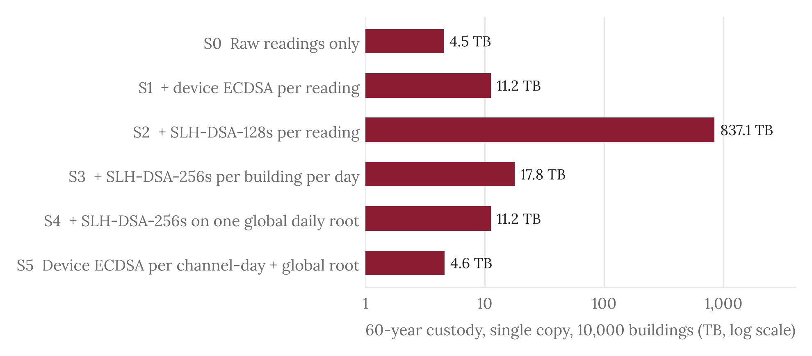
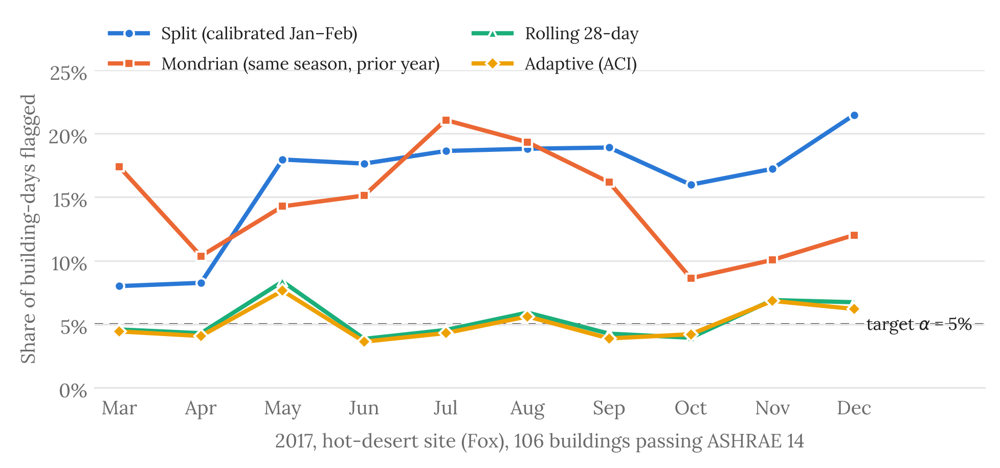
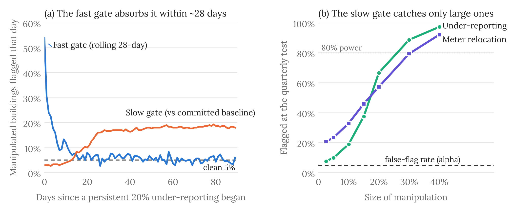

# 05 · Results

**Published E1–E4 research highlights**. The artifacts in this section are copied **byte for byte** from the archived source outputs under [Reference & Tests](../reference-and-tests/results/). The repository health check verifies that their hashes still match. The complete, reproducible experimental record remains there.

| Experiment | Research question | Key files |
| --- | --- | --- |
| **E1: Storage & custody** | What storage is added by signed evidence and archival policies? | [Summary](e1/e1_summary.json) · [Figure](e1/e1_custody_volume.png) |
| **E2: Calibration** | Does the statistical gate retain its nominal alert rate under seasonal drift? | [Summary](e2/e2_summary.json) · [Figure](e2/e2_flag_rates_fox.png) |
| **E3: Detection limit** | Which alterations are detectable, and what happens under manipulation prevalence? | [Quarterly test](e3/e3a_quarterly.json) · [Additional power test](e3/e3a_extra.json) · [Other modes](e3/e3b_results.json) · [Figure](e3/e3_gates_fox.png) |
| **E4: Review economics** | How many cases and what cost follow from a given alert threshold? | [Results](e4/e4_results.json) · [Cost model](../reference-and-tests/DIYAR_cost_model.xlsx) |

## Figures

**E1 · Storage and custody**

**E2 · Seasonal calibration**

**E3 · Statistical detection**

## How to interpret these figures

The reference reports **17.4%** one-time-calibration alerts on seasonal data against a nominal **5%** and approximately nominal alert rates after recent-window calibration. With one manipulated building among honest peers, the quarterly test reportedly reaches **80% detection** around a **25% under-report** in the studied setup; this is not universal statistical protection. Annual operating cost is estimated near **USD 179/building** under the whitepaper's inspection, onboarding and staffing assumptions, not observed commercial pricing.

These are **reported prototype study findings**, not production validation. Consult [the whitepaper and annexes](../paper/DIYAR%20whitepaper%20v2.7.pdf), [full experiment outputs](../reference-and-tests/results/), [reconciliation](../reference-and-tests/reconciliation.csv) and the [independent verification record](../reference-and-tests/VERIFY_2026-11-06.md) for details. Do not edit highlights manually; rerun and reconcile their source first.